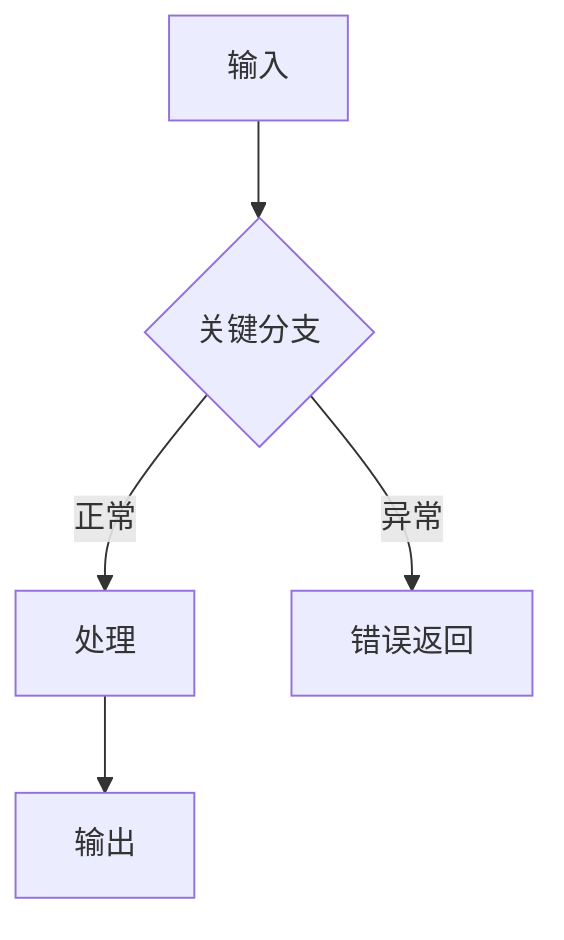
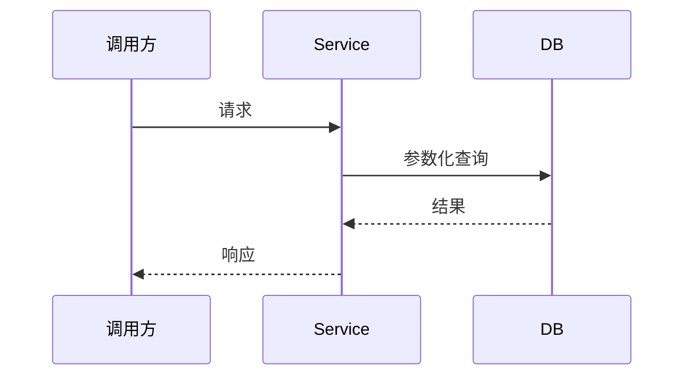

# 方案预览 — <change-name>

> 一页内看完；确认方向后再展开 proposal/design/spec 与代码。平凡需求可跳过本文件。

## 1. 目标与范围
- 做什么：
- 不做什么（Non-Goals）：
- 成功后可观察的现象：

## 2. 主流程（Mermaid）



涉及时序时补：



## 3. 模块/分层草图
| 组件 | 职责（一句话） | 依赖 |
|---|---|---|
| Controller | 入参/状态码 | Service |
| Service | 业务规则 | Dao |
| Dao | 参数化持久化 | DB |

关键接口签名/数据模型（伪代码即可，不写实现）：
```
<类型/接口草图>
```

## 4. 关键取舍（≤4 个）
1. <选项 A vs B> → 推荐：<…>，理由：<…>

## 5. 风险与待确认
- 风险：
- 待你确认：

---
确认意见：☐ 方向 OK，展开正式方案　☐ 需要调整（指出点）
