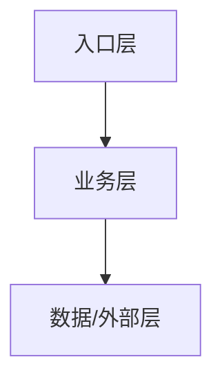

# 项目架构画像 — <项目名>

> 进场摸底产出（intake），随仓库演进增量更新。最后更新：YYYY-MM-DD

## 1. 定位与技术栈
- 一句话定位：
- 语言/框架/运行方式：
- 依赖与中间件：

## 2. 架构分层

## 3. 模块职责
| 模块/包 | 职责（一句话） | 关键依赖 | 备注 |
|---|---|---|---|
| | | | |

## 4. 观察到的代码约定
- 命名：
- 分层/包组织：
- 异常与错误处理：
- 日志：
- 格式化/静态检查工具：
- 与通用规范 checklist 的差异及取舍（入乡随俗 vs 按规范整改）：

## 5. 构建、测试与检查命令
| 用途 | 命令 |
|---|---|
| 构建 | |
| 测试 | |
| 静态检查 | |
| 本地运行 | |

## 6. 测试现状与风险点
- 测试覆盖印象：
- 跑不通/脆弱的测试：
- 高风险模块：

## 7. 待确认问题
-
